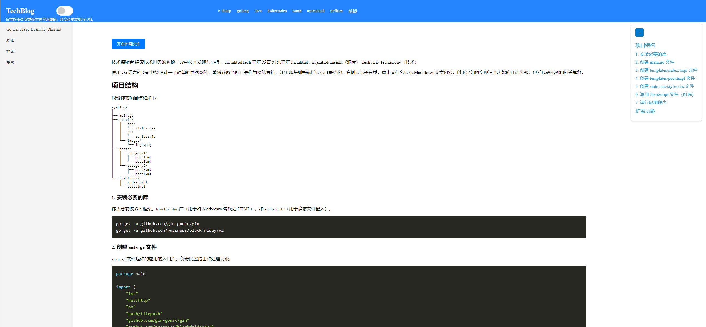
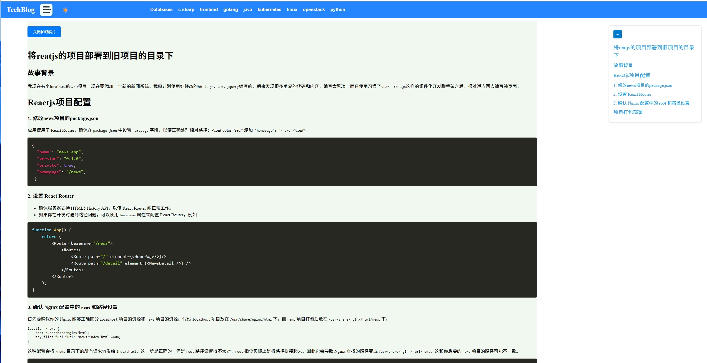
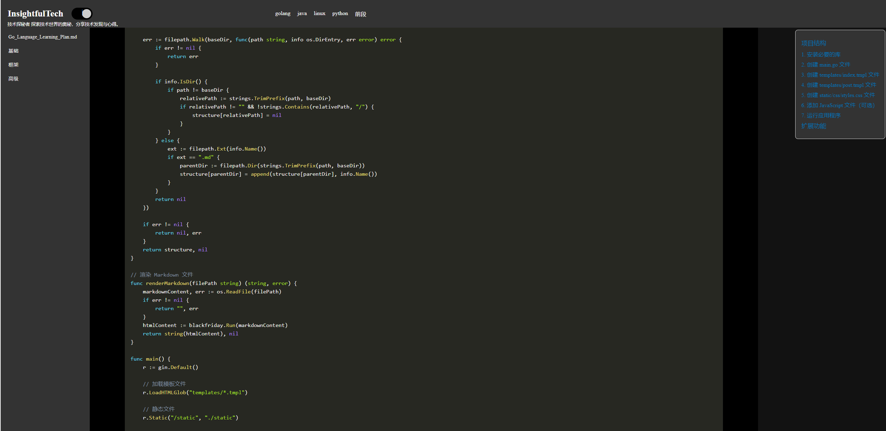
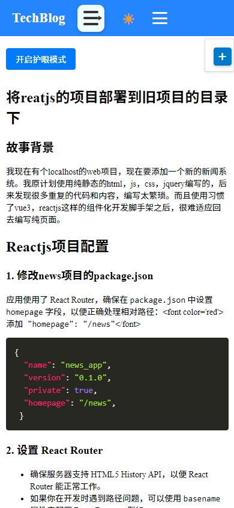
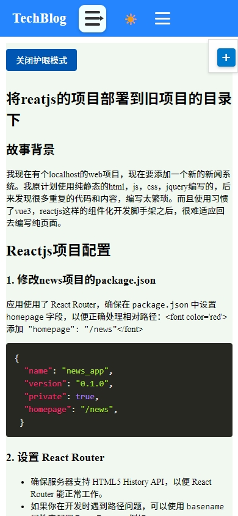
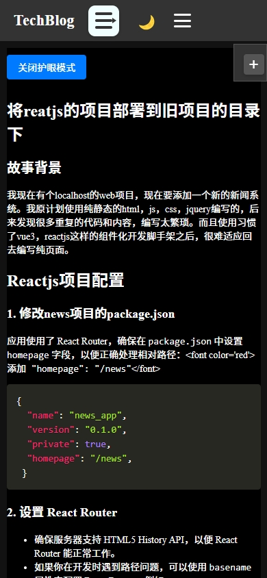
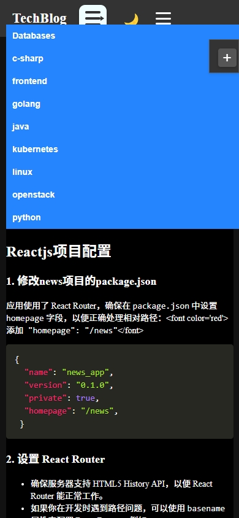
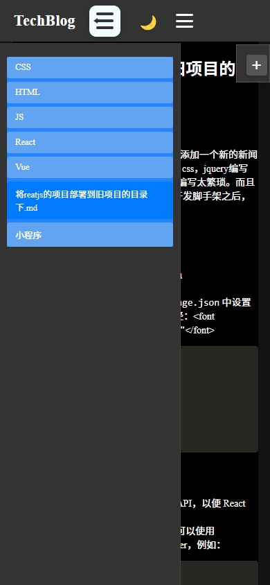

<p align="center">
  
</p>

<h1 align="center">AldusBlog</h1>

<p align="center">
  基于 React + Vite 的纯前端 Markdown 博客系统，将本地 Markdown 文件夹变成结构化的在线文档站点，支持 Docker Compose 本地部署、nginx 实时读取笔记目录
</p>

<p align="center">
  <a href="https://github.com/caojp/aldus-blog/actions"></a>
  
  
  
  
</p>

---

## 目录

- [目录](#目录)
- [功能特性](#功能特性)
- [架构说明](#架构说明)
- [截图预览](#截图预览)
    - [常规模式](#常规模式)
    - [护眼模式](#护眼模式)
    - [暗黑模式](#暗黑模式)
    - [移动端](#移动端)
- [技术栈](#技术栈)
- [前置条件](#前置条件)
- [快速开始](#快速开始)
  - [方式一：Docker Compose（推荐）](#方式一docker-compose推荐)
  - [方式二：本地开发](#方式二本地开发)
- [项目结构](#项目结构)
- [内容目录约定](#内容目录约定)
- [配置说明](#配置说明)
  - [开发：POSTS_DIR](#开发posts_dir)
  - [生产：VITE_POSTS_URL 与 nginx](#生产vite_posts_url-与-nginx)
- [配置评论（Giscus，可选）](#配置评论giscus可选)
- [部署](#部署)
  - [方式一：Docker Compose](#方式一docker-compose)
  - [方式二：静态托管](#方式二静态托管)
  - [方式三：本地预览](#方式三本地预览)
- [参与贡献](#参与贡献)
- [开源许可](#开源许可)

## 功能特性

- 📂 **目录即导航** — 自动读取 Markdown 目录结构，顶层目录生成顶部导航，子目录/文件生成左侧多级导航（懒加载，按需展开）
- 📝 **Markdown 渲染** — GFM 语法、脚注支持、Mermaid 流程图（懒加载 + 全屏拖拽/缩放）、代码高亮（5 种风格可切换）、一键复制代码
- 🖼️ **相对路径图片修复** — 文章内的相对路径图片自动解析到正确位置，笔记目录可整体迁移
- 🔍 **全文搜索** — 按标题/路径即时搜索文章，结果实时高亮
- 🏷️ **标签系统** — 顶部按一级目录生成分类标签，独立标签页聚合浏览
- 📊 **阅读信息** — 每篇文章自动统计字数、阅读时长、发布日期
- 📑 **文档目录** — 自动提取文章标题生成右侧 TOC，滚动高亮 + 锚点跳转
- 📖 **阅读体验** — 阅读进度条、上下篇导航、首页概览（文章数/目录数/最近更新）
- 🌗 **主题切换** — 亮色 / 暗色 / 护眼模式，支持跟随系统偏好，本地持久化
- 💬 **Giscus 评论** — 评论区组件已集成（需在 giscus.app 配置后启用，见下文）
- 📱 **响应式适配** — 显示器 / 笔记本 / 手机三档排版，桌面端可拖拽侧边栏，移动端抽屉式导航
- 🔗 **可分享链接** — 文章路径写入 URL（含中文、`#`、空格等特殊字符的安全编码），刷新即恢复，可直接分享
- ⚡ **性能优化** — Mermaid 懒加载（仅含图文章才下载）、vendor 分包缓存、文章内容会话级缓存
- 📦 **纯前端架构** — 无后端依赖，生产由 nginx 实时读取笔记目录，改笔记即发布

## 架构说明

| 模式 | 内容来源 | 说明 |
|---|---|---|
| **开发** `npm run dev` | Vite 虚拟模块（`virtual:posts`） | 启动时用 Node.js 递归扫描 `POSTS_DIR` 并把所有 `.md` 打包进模块，监听目录变化自动热更新 |
| **生产**（Docker/nginx） | nginx 运行时 HTTP 拉取 | 笔记目录以**只读卷挂载**进容器，nginx `autoindex json` 提供目录树、按需拉取 `.md` 原文；**本地改笔记刷新即生效，无需重新构建** |

生产环境不需要 `POSTS_DIR`：前端通过 `VITE_POSTS_URL`（默认 `/posts`）运行时拉取，对应 nginx.conf 中 `location /posts/` 的 `alias` 路径。

## 截图预览

#### 常规模式


#### 护眼模式


#### 暗黑模式


#### 移动端
<p float="left">
  
  
  
  
  
</p>

## 技术栈

| 层 | 技术 | 版本 |
|---|---|---|
| **前端框架** | React | 18 |
| **构建工具** | Vite | 5 |
| **Markdown 渲染** | react-markdown + remark-gfm（脚注） | 9 / 4 |
| **Mermaid 图表** | mermaid（懒加载） | 11 |
| **代码高亮** | react-syntax-highlighter（PrismLight 按需加载） | 15 |
| **路由** | react-router-dom | 6 |
| **评论** | Giscus（GitHub Discussions，可选） | — |
| **部署** | nginx（Docker Compose） | — |

## 前置条件

- **Docker**（推荐，用于 `docker compose` 一键部署）
- 本地开发另需 **Node.js ≥ 18** 和 **npm ≥ 9**（或 pnpm / yarn）

## 快速开始

### 方式一：Docker Compose（推荐）

仓库内置 `docker-compose.yml`，把本机笔记目录**只读挂载**进容器：

```bash
# 1. 编辑 docker-compose.yml，把卷左侧路径改成你的笔记目录
#    volumes: - /Users/Yolanda/caojp/awesome-me:/opt/aldus-blog/awesome-me:ro

# 2. 构建并启动
docker compose up -d --build

# 3. 打开
#    http://localhost:8090
```

本地新增/修改笔记后，刷新页面即生效，无需重新构建。停止：`docker compose down`。

### 方式二：本地开发

```bash
# 1. 克隆仓库
git clone https://github.com/caojp/aldus-blog.git
cd aldus-blog

# 2. 配置 Markdown 目录（见「配置说明 · 开发：POSTS_DIR」）
#    macOS/Linux 推荐写入 frontend/.env.development.local（gitignored）：
#    POSTS_DIR=/path/to/your/notes

# 3. 启动
cd frontend
npm install
npm run dev
```

开发服务器默认运行在 `http://localhost:5173`，新增/修改 `.md` 文件自动热更新。

## 项目结构

```
aldus-blog/
├── frontend/                     # React 前端（唯一需要开发的）
│   ├── src/
│   │   ├── api/content.js        # 内容加载层（dev 虚拟模块 / prod HTTP 拉取，含缓存与路径编码）
│   │   ├── components/           # TopNav、SideNav、MarkdownRenderer、ThemeSwitcher、TOC、
│   │   │                         # ArticleMeta、PrevNextNav、ReadingProgressBar、HomeOverview、
│   │   │                         # MermaidFullscreen、GiscusComments 等
│   │   ├── lib/                  # nav.js（导航树）、search.js（搜索）、stats.js（字数/时长）
│   │   ├── pages/                # HomePage（首页）、SearchPage（搜索）、TagPage（标签）
│   │   └── styles/
│   ├── public/                   # favicon.ico、aldus-logo.svg 等静态资源
│   ├── .env.development          # 开发 POSTS_DIR（Windows 示例）
│   ├── .env.development.local    # 本机覆盖（gitignored，不污染仓库）
│   ├── .env.production           # VITE_POSTS_URL（生产内容拉取地址）
│   └── vite.config.js            # posts-plugin 虚拟模块 + 分包/懒加载优化
├── docker-compose.yml            # 一键部署：构建 + 卷挂载笔记目录 + 端口映射
├── Dockerfile                    # 多阶段构建：前端产物 + nginx
├── nginx.conf                    # nginx 配置（/posts/ autoindex、SPA fallback、缓存、安全头）
├── image/                        # README 截图
└── readme.md
```

## 内容目录约定

```
notes/  （你的笔记目录，例如 awesome-me）
│   index.md                  # 首页展示的内容
│
├───golang                    # 一级目录 → 顶部导航 / 分类标签
│   │   Go_Learning_Plan.md   # 文章 → 左侧导航
│   │
│   ├───基础                  # 二级目录 → 左侧可折叠
│   │       post1.md
│   │
│   └───框架
│       ├───gin              # 三级目录 → 左侧可折叠
│       └───orm
│
├───kubernetes
├───linux
└───python
```

- 顶层目录显示在**顶部导航栏**和**分类标签**
- 子目录和文件显示在**左侧导航栏**，支持多级折叠（懒加载展开）
- `index.md` 作为首页默认内容
- 只有包含 `.md` 文件的目录才会出现在导航中
- 文章内图片使用**相对路径**即可，渲染时会自动修复（支持中文名、空格路径）

## 配置说明

### 开发：POSTS_DIR

`.env.development` 配置开发环境的 Markdown 内容目录（Windows 反斜杠正斜杠都行）：

```bash
POSTS_DIR=D:\awesome-me        # Windows 绝对路径示例
POSTS_DIR=/home/user/notes     # Linux/Mac 绝对路径示例
```

macOS/Linux 本机路径建议写入 `frontend/.env.development.local`（gitignored，不污染仓库）：

```bash
POSTS_DIR=/Users/you/awesome-me
```

### 生产：VITE_POSTS_URL 与 nginx

生产环境前端运行时通过 HTTP 拉取内容，`frontend/.env.production`：

```bash
# 此 URL 对应 nginx.conf 中 location /posts/ 的 alias 路径
VITE_POSTS_URL=/posts
```

`nginx.conf` 关键配置：`location /posts/` 用 `alias` 指向服务器上的笔记目录，开启 `autoindex on; autoindex_format json;` 让前端递归获取目录树。同源部署保持 `/posts` 即可；跨源部署时配置为完整 URL（nginx 已带 CORS 头）。

## 配置评论（Giscus，可选）

评论区组件（`frontend/src/components/GiscusComments.jsx`）已集成，启用步骤：

1. 确保你的 GitHub 仓库公开并开启 **Discussions**（Settings → General → Features）
2. 在 [giscus.app](https://giscus.app) 按页面指引选择仓库，复制生成的 4 个配置值（`repo` / `repoId` / `category` / `categoryId`）
3. 填入 `GiscusComments.jsx` 的 `GISCUS_CONFIG` 对应字段，重新构建部署即可

## 部署

### 方式一：Docker Compose（推荐）

```bash
docker compose up -d --build   # 构建镜像并后台启动（默认 http://localhost:8090）
docker compose down            # 停止容器
```

默认挂载 `/Users/Yolanda/caojp/awesome-me:/opt/aldus-blog/awesome-me:ro`——把卷左侧改成你自己的笔记目录即可，新增/修改 Markdown 刷新即生效。

### 方式二：静态托管

项目是纯前端，构建产物 `frontend/dist/` 可部署到任意静态托管。注意：内容目录也需要能被 HTTP 访问（用 nginx `alias` + `autoindex json`，或放到任意静态服务），并在构建时把 `VITE_POSTS_URL` 指到对应地址：

```bash
cd frontend
npm run build
# dist/ 目录上传即可
```

| 平台 | 特点 |
|---|---|
| **GitHub Pages** | 免费，push 自动构建 |
| **Vercel** | 免费额度大，零配置 |
| **Netlify** | 免费额度大，拖拽部署 |
| **Nginx** | 自建服务器（参考仓库内 nginx.conf） |

### 方式三：本地预览

```bash
cd frontend
npm run build
npm run preview
```

预览时 `VITE_POSTS_URL` 需要指向可达的内容服务，否则只渲染界面、内容为空。

## 参与贡献

欢迎提交 Issue 和 PR！请先阅读 [贡献指南](CONTRIBUTING.md)。

- 提交前请确保 `npm run lint` 和 `npm run build` 通过
- 遵循 [约定式提交](https://www.conventionalcommits.org/zh-hans/) 规范
- 报告安全漏洞请参见 [安全策略](SECURITY.md)

## 开源许可

本项目基于 [MIT License](LICENSE) 开源。
